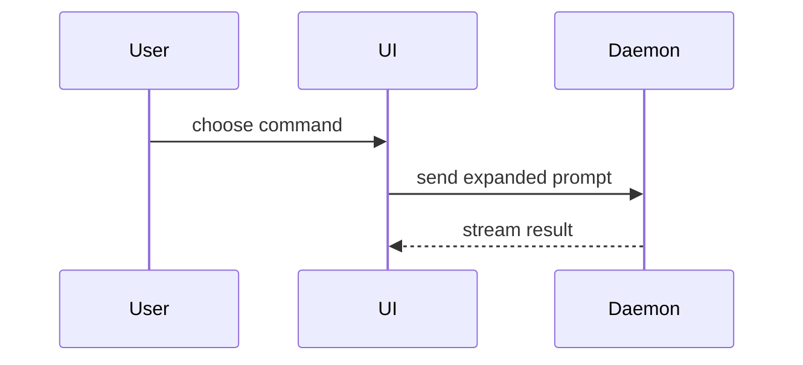

# Views

Ways to show the shape of code. Research, design, the outline and PR descriptions all use these. Pick the smallest view that makes the point, and put it beside the short text it supports. Keep only the calls, files, fields and states the reader needs.

Adapted from the `show-me` reference in humanlayer's `rpi` plugin.

## Which view for which point

| The point is about | Use |
| --- | --- |
| Logic or an algorithm | Pseudocode |
| How control flows at run time | A call tree |
| UI structure | A component tree |
| Which file owns what, or a broad refactor | A shallow file tree |
| How components talk, or how data moves | A Mermaid diagram |
| A contract between components | A signature, an endpoint shape, or a schema |
| Which dependencies a unit receives | A dependency map |
| A comparison or a matrix | A table |
| A layout or a visual state | One focused HTML file |

## Current state or a change

Research describes what exists. It uses plain blocks and never a `diff` block.

Design and the outline describe a change. Use a `diff` block when the surrounding shape already exists and the point is what changes. Show the whole block when most of it is new, or when leaving out context would hide ownership or order.

In a `diff` block, start an added or changed line with `+`, a removed line with `-`, and an unchanged line with a space.

## Pseudocode

Plain language, not a programming language.

```text
on(save)
  if content is unchanged
    return cached result
  write new content
  return fresh result
```

## Call tree

Show the important calls, not every frame.

```text
submitForm
  createSession
    persistPrompt
    launchAgent
  navigateToSession
```

As a change:

```diff
 submitForm
   createSession
     persistPrompt
+    expandSkillMention
     launchAgent
```

## Component tree

Include the state and the package boundaries that matter. Adapt the syntax to the UI framework in use.

```tsx
<SessionPage> (apps/example/src/routes/session.tsx)
  useSessionEvents()
  <SessionToolbar>
    <RunSkillButton> (packages/ui)
```

## File tree

Format it like `tree` output, with the glyphs `├──`, `└──` and `│`. Keep it shallow. Group related files under their shared directory and leave out unchanged paths unless they give needed context.

```text
src/
├── commands/       # parses user actions
├── sessions/       # owns session state
└── transport/      # sends API requests
```

As a change:

```diff
 src/
 ├── commands/
+│   └── show-me.ts       # expands the slash command
 ├── sessions/
-└── transport.ts
+└── transport/
+    ├── client.ts
+    └── stream.ts
```

## Mermaid diagram



## Contracts

Use the codebase's own language for a signature. Use whatever form the project uses for a schema, such as SQL or its ORM's definitions.

```text
createResource(input: CreateResourceInput) -> Resource

PUT /api/resources/:slug
  request:  { destination: string }
  response: { resource: Resource }
```

```diff
 records
   id                 uuid primary key
+  status             text not null
-  legacy_flag        boolean
```

## Dependency map

Group by the unit that receives the dependencies. Say what each one lets the code do.

```text
createResourceWorkflow
  receives resourceStore    -> persists resources
  receives eventPublisher   -> emits resource-created events after commit
  receives clock            -> makes timestamps deterministic
```

## HTML file

For a UI layout, a visual state comparison, or a concept too dense for Mermaid, write one focused HTML file to `.planning/<feature>/` and name its path beside the text it supports. Match the product's own colours, type, spacing and components. Use real labels and data.
