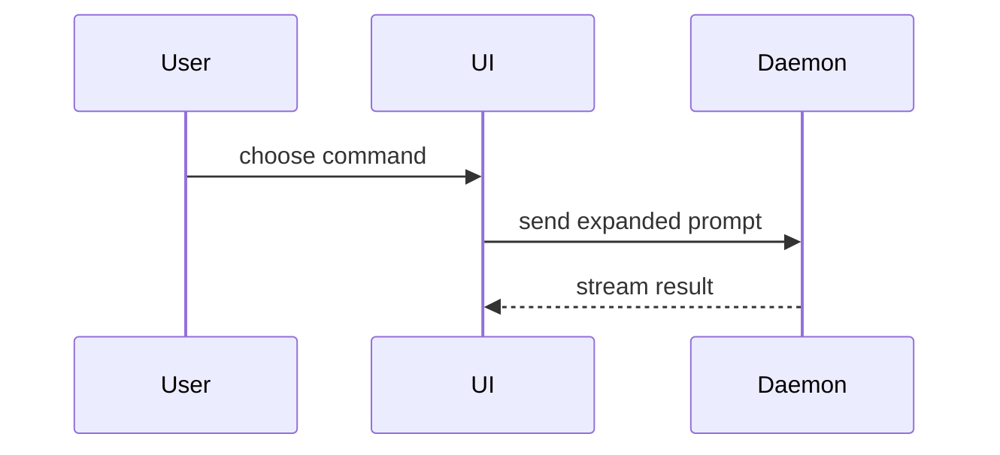

# Show me

Show the shape of code. Pick the smallest view that makes the point, and put it beside the short text it supports.

Adapted from the `show-me` skill in [humanlayer/skills](https://github.com/humanlayer/skills), with the contract and dependency-map views from its `rpi` skill.

## Two ways this file is used

**A person typed `/taith:show-me`.** Explain the current topic of the conversation with these views. Skip the preamble and keep the prose brief. When the topic is code you have not read, get the facts through the **how** skill (`../how/SKILL.md`) first.

**Another skill sent you here.** Use the views in the document that skill is writing. That skill says whether the document describes the current state or a change.

## Rules for every view

- Keep only the calls, files, props, states and boundaries that the question or the decision in front of the reader needs.
- Use one view or several. You will rarely need all of them. Too many views hide the point as well as a wall of prose does.
- Put each view directly after the sentence it supports. Never collect the views at the end.
- Use real names from the code, not placeholders.

## Which view for which point

| The point is about | Use |
| --- | --- |
| Logic or an algorithm | Pseudocode |
| How control flows at run time | A call tree |
| UI structure | A component tree |
| Which file owns what, or a broad refactor | A shallow file tree |
| How components talk, or how data moves | A Mermaid diagram |
| A contract between components | A signature, an endpoint shape, or a schema |
| Which dependencies a unit receives | A dependency map |
| A comparison or a matrix | A table |
| A layout, a visual state, or a concept too dense for Mermaid | One focused HTML file |

## Current state or a change

Research describes what exists. It uses plain blocks and never a `diff` block.

Design, the outline and a PR description describe a change. Use a `diff` block when the surrounding shape already exists and the point is what changes. Any view below can be a diff. Match the shape of the diff to the topic: a component tree for a component change, a file tree for a layout change.

Show the whole block and no diff in three cases: most of it is new, leaving out context would hide ownership or order, or the reader needs a target shape to copy.

In a `diff` block, start an added or changed line with `+`, a removed line with `-`, and an unchanged line with a space.

When you compare options, give each option its own block.

## Pseudocode

Plain language, not a programming language.

```text
on(save)
  if content is unchanged
    return cached result
  write new content
  return fresh result
```

As a change:

```diff
 on(save)
-  write content
+  if content is unchanged
+    return cached result
+  write new content
+  invalidate cache
```

## Call tree

Show the important calls, not every frame.

```text
submitForm
  createSession
    persistPrompt
    launchAgent
  navigateToSession
```

As a change:

```diff
 submitForm
   createSession
     persistPrompt
+    expandSkillMention
     launchAgent
-  navigateToSession
+  navigateToSession
+    subscribeToEvents
```

## Component tree

Include the state and the package boundaries that matter. Adapt the syntax to the UI framework in use.

```tsx
<SessionPage> (apps/example/src/routes/session.tsx)
  useSessionEvents()
  <SessionToolbar>
    <RunSkillButton> (packages/ui)
```

As a change:

```diff
 <SessionPage>
   useSessionEvents()
   <SessionToolbar>
+    <RunSkillButton />
   <SessionTimeline>
+    <SkillResultCard />
```

## File tree

Format it like `tree` output, with the glyphs `├──`, `└──` and `│`. Keep it shallow. Group related files under their shared directory and leave out unchanged paths unless they give needed context.

```text
src/
├── commands/       # parses user actions
├── sessions/       # owns session state
└── transport/      # sends API requests
```

As a change:

```diff
 src/
 ├── commands/
+│   └── show-me.ts       # expands the slash command
 ├── sessions/
-└── transport.ts
+└── transport/
+    ├── client.ts
+    └── stream.ts
```

## Mermaid diagram

Use it for a sequence, a data flow, a control flow or a component graph.



## Contracts

Use the codebase's own language for a signature. Use whatever form the project uses for a schema, such as SQL or its ORM's definitions.

```text
createResource(input: CreateResourceInput) -> Resource

PUT /api/resources/:slug
  request:  { destination: string }
  response: { resource: Resource }
```

As a change:

```diff
 records
   id                 uuid primary key
+  status             text not null
-  legacy_flag        boolean
```

## Dependency map

Group by the unit that receives the dependencies. Say what each one lets the code do.

```text
createResourceWorkflow
  receives resourceStore    -> persists resources
  receives eventPublisher   -> emits resource-created events after commit
  receives clock            -> makes timestamps deterministic
```

## HTML file

For a UI layout, a visual state comparison, or a concept too dense for Mermaid, write one focused HTML file. It can be a diagram, an infographic, a mock-up, or a short slide deck.

- Match the product's own colours, type, spacing and components. Research records them when the work may touch a UI.
- Use real labels and data.
- Make it work at desktop and phone widths.
- Name it for what it shows, such as `mockup-import-dialog.html` or `diagram-retry-flow.html`.
- Inside a feature, save it in `.planning/<feature>/` and link it beside the text it supports. Update it when a decision changes what it shows.
- Typed alone with no feature folder, save it in a temporary directory.
- Tell the person the path. Open it for them when the session runs on their machine, with `open` on macOS or `xdg-open` on Linux.
